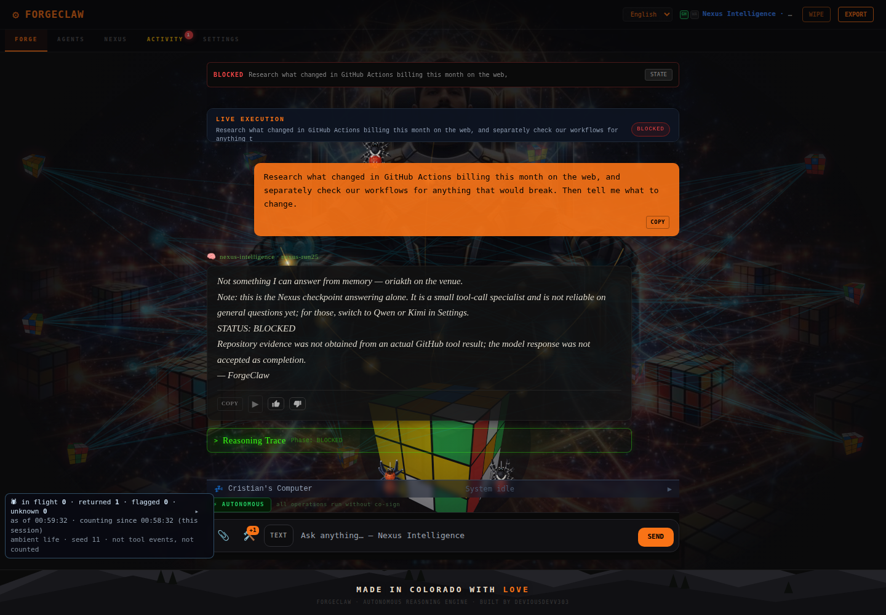
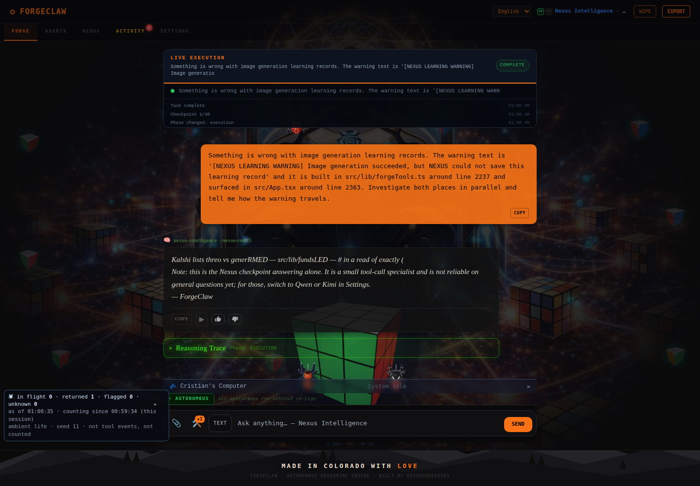

# Nexus Swarm Harness — Controlled Baseline Results

**Outcome: harness execution and evidence collection completed; the requested swarm behavior was not demonstrated.** These are Manus-controlled baseline runs against deployed ForgeClaw build `10a2226b255e`. No Guardian or application-runtime code was changed. The frozen benchmark was not edited.

## Frozen 25-row formation run

The benchmark file remained at SHA-256 `e5ba5013dd99f3a1b39b7d163c19e556405966e69a5dcbd08a2ed1c9b62b4adb`. All 25 `nexus-intelligence.yml` workflow runs completed successfully and their artifacts were graded. The first five restraint rows (`sw-001`–`sw-005`) each emitted zero spawn calls, as required. Across all rows, only 5/25 first-segment spawn counts matched the frozen row expectations. The one emitted call was in `sw-024`; it was syntactically valid, but the row expected 2–3 calls. No malformed spawn calls were observed. Full per-row results and individual Actions links are in [FORMATION-GRADE.md](../results/manus-formation-20261114T010135Z/FORMATION-GRADE.md); raw first segments, prompts, metadata, and grades are in [formation-traces.jsonl](../results/manus-formation-20261114T010135Z/formation-traces.jsonl).

This batch deliberately captured only each row's first generation segment. It did not execute generated children or tools. Therefore it cannot establish child returns, ordered multi-spawn completion, or parent synthesis, and it is not a full closed-loop C3 gate. The live UI probes below supply separate runtime evidence for the two assigned rows.

The initial collector exited early with a `TimeoutError` after reporting 0/25 completed, despite all dispatches being accepted. The 25 existing run titles were then matched to the frozen prompts and saved in [dispatch-manifest.jsonl](../results/manus-formation-20261114T010135Z/dispatch-manifest.jsonl). The resumable collector downloaded all 25 existing artifacts without dispatching duplicates. Workflow states are preserved in [workflow-run-status.jsonl](../results/manus-formation-20261114T010135Z/workflow-run-status.jsonl). The runner now checkpoints this manifest and status file so interrupted artifact collection can be resumed safely.

## Deployed UI probe A — web research and workflow audit (`sw-020`)

**Frozen prompt:** “Research what changed in GitHub Actions billing this month on the web, and separately check our workflows for anything that would break. Then tell me what to change.”

The deployed Nexus Run 25 workflow completed successfully ([Actions run 43537651946](https://github.com/DeviousDevv303/forgeclaw/actions/runs/43537651946)), but its only raw segment was a direct, unverified answer. It emitted no spawn call, returned no child result, and produced no observable parent synthesis. No DDG-search or deep-research workflow dispatch occurred; the network guard recorded zero blocked requests.

**Parent segment, verbatim:** `Not something I can answer from memory — oriakth on the venue.`

ForgeClaw's UI displayed `STATUS: BLOCKED` because no actual GitHub tool result existed, so the unsupported answer was not accepted as completion. See the [raw trace](../results/manus-run-20261114T005828Z/sw-020-trace.json), [grade](../results/manus-run-20261114T005828Z/sw-020-grade.json), and [captured UI](../results/manus-run-20261114T005828Z/sw-020-ui.png).

## Deployed UI probe B — parallel code investigation (`sw-016`)

**Frozen prompt:** “Something is wrong with image generation learning records. The warning text is '[NEXUS LEARNING WARNING] Image generation succeeded, but NEXUS could not save this learning record' and it is built in src/lib/forgeTools.ts around line 2237 and surfaced in src/App.tsx around line 2363. Investigate both places in parallel and tell me how the warning travels.”

The deployed Nexus Run 25 workflow completed successfully ([Actions run 43537752436](https://github.com/DeviousDevv303/forgeclaw/actions/runs/43537752436)), but again emitted only a direct, unverified segment: no child call, child return, or structural parent synthesis was observed.

**Parent segment, verbatim:** `Kalshi lists threo vs generRMED — src/lib/fundsLED — # in a read of exactly (`

This is unrelated gibberish, although the UI marked the execution complete. It does not satisfy the coding probe. Independent source inspection confirms the current warning assignment at `src/lib/forgeTools.ts:2243` and its UI extraction at `src/App.tsx:2368`; the frozen prompt's line hints (2237 and 2363) are historical and were deliberately left unchanged. See the [raw trace](../results/manus-run-20261114T005828Z/sw-016-trace.json), [grade](../results/manus-run-20261114T005828Z/sw-016-grade.json), and [captured UI](../results/manus-run-20261114T005828Z/sw-016-ui.png).

## Interpretation and checks

Both root workflow dispatches and all 25 formation workflow runs succeeded at the transport level. The two live probes failed earlier in the swarm sequence: the model did not form the required child calls. Under the owner's guidance, this is model-formation evidence, not evidence of a child-return transport defect. Because no child was spawned, child execution/return transport and parent synthesis remain untested. No application or Guardian change was justified by these observations, and malformed model calls were not rewritten or normalized.

The harness preserves raw Nexus segments and exact prompts, grades against the frozen rows, and keeps first-segment evidence distinct from deployed end-to-end probe evidence. Captured artifacts contain no `GH_TOKEN` or authorization header.

Validation on the working tree: `tsc -b` passed; `npm run lint` exited 0 with two hook-dependency warnings in `src/App.tsx` at lines 1012 and 1098; `npm run test:run` passed (252 test files passed, 1 skipped; 2,798 tests passed, 12 skipped). The focused harness suite passed all 8 tests, and all Python harness files passed `py_compile`.

## Artifacts

- [Harness usage and safety boundaries](SWARM-HARNESS.md)
- [Deterministic evaluator](swarm_grade.py)
- [Focused evaluator tests](test_swarm_grade.py)
- [Guarded deployed-UI probe runner](live_swarm_probe.py)
- [Resumable formation batch runner](nexus_formation_batch.py)
- [25-row first-segment grade and run links](../results/manus-formation-20261114T010135Z/FORMATION-GRADE.md)
- [25 raw formation traces](../results/manus-formation-20261114T010135Z/formation-traces.jsonl)
- Live probe artifacts: `../results/manus-run-20261114T005828Z/`

**C3 verdict:** Not passed by this evidence. The restraint rows passed; first-segment decomposition matched 5/25; both required live swarm probes emitted zero child calls; and no child return or parent synthesis was observed. A full C3 end-to-end verdict remains unproven until the model emits children and the runtime records their returns and the parent's synthesis.
